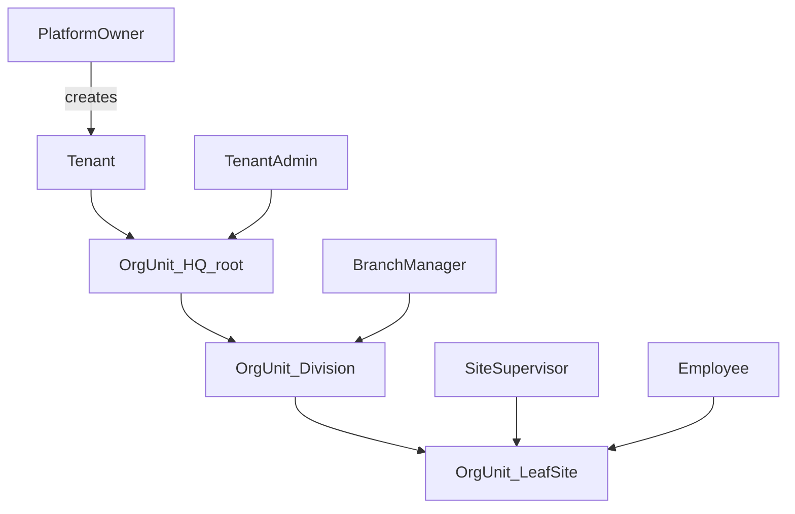

# Complete Hierarchy System Specification (MD File)

## Deliverable

One new file: **[docs/COMPLETE_HIERARCHY_SPEC.md](docs/COMPLETE_HIERARCHY_SPEC.md)** at workspace root `d:/attendacehimanshu/docs/`.

No code changes—documentation only. The doc will be written from the live implementation in backend, dashboard, and mobile app.

---

## Document structure (15 sections)

### 1. Overview and mental model

- **Three layers**: Platform → Tenant → Org tree → Users
- **Two node types**: `isLeaf: false` (branch/division) vs `isLeaf: true` (leaf site)
- **Two portals**: `platform` (platform owner), `tenant` (HQ + managers dashboard), `employee` (mobile app)
- Mermaid diagram:

---

### 2. Stage 0 — Platform owner defines tenant shape

**Source**: [attendace-backend/src/controllers/platform.controller.js](attendace-backend/src/controllers/platform.controller.js)

Document step-by-step what happens when platform owner creates a tenant:

| Input                                                     | Purpose                                                      |
| --------------------------------------------------------- | ------------------------------------------------------------ |
| `name`, `slug`                                            | Tenant identity                                              |
| `levels[]`                                                | **How many hierarchy levels** the tenant supports (min 2)    |
| Each level: `levelOrder`, `code`, `displayName`, `isLeaf` | Level metadata; **exactly one** level must be `isLeaf: true` |
| `rootOrgName`                                             | Name of the HQ root org unit                                 |
| `tenantAdmin`                                             | Optional first HQ admin user                                 |

**Auto-seeded on tenant create**:

- `TenantHierarchyLevel` rows (template for level names)
- Root `OrgUnit` (`parentId: null`, `levelOrder: 1`, `isLeaf: false`, `path: /{tenantId}/`)
- `TenantApprovalLevel` (L1 Site, L2 Division, L3 HQ)
- Default `ApprovalPolicy` per request type
- Optional `tenant_admin` user bound to root org unit

**Rule to port**: `maxHierarchyDepth = levels.length`; org units use `levelOrder` on each node; leaf flag is on the **instance**, not only the template.

---

### 3. Stage 1 — Org unit data model

**Source**: [attendace-backend/src/models/org-unit.model.js](attendace-backend/src/models/org-unit.model.js)

Fields and purpose:

| Field             | Purpose                                                            |
| ----------------- | ------------------------------------------------------------------ |
| `tenantId`        | Multi-tenant isolation                                             |
| `parentId`        | Tree parent (null = HQ root)                                       |
| `levelOrder`      | Depth in tenant hierarchy (HQ=1, division=2, site=3, etc.)         |
| `name`            | Display name                                                       |
| `path`            | Materialized path `/{tenantId}/{id}/.../` for fast subtree queries |
| `isLeaf`          | `false` = division branch; `true` = operational leaf site          |
| `status`          | `active` or `pending_hq_approval`                                  |
| `createdByUserId` | Audit who proposed the node                                        |

**Path resolution** ([org-scope.service.js](attendace-backend/src/services/org-scope.service.js)): `getDescendantOrgUnitIds` filters all units where `path.startsWith(root.path)` — this is how scope inheritance works.

---

### 4. Stage 2 — Roles and who uses what

**Source**: [attendace-backend/src/constants/enums.js](attendace-backend/src/constants/enums.js), [attendace_Dashboard/src/lib/roles.ts](attendace_Dashboard/src/lib/roles.ts)

| Role                     | Bound to org unit | Dashboard        | Can create org units                  | Can create users                   |
| ------------------------ | ----------------- | ---------------- | ------------------------------------- | ---------------------------------- |
| `platform_owner`         | N/A               | Platform console | Tenants                               | Tenant admins                      |
| `tenant_admin` / `admin` | HQ root           | HQ + full ops    | Divisions, sites (active immediately) | All manager + employee roles       |
| `branch_manager`         | Division node     | Scoped dashboard | Leaf sites only (pending HQ)          | Site heads + employees in division |
| `site_supervisor`        | Leaf site         | Site dashboard   | None                                  | Employees at site only             |
| `employee`               | Leaf site         | Mobile app only  | None                                  | None                               |

**Login rules** ([auth.controller.js](attendace-backend/src/controllers/auth.controller.js)): employees must be `approved`; dashboard roles must be in `TENANT_DASHBOARD_ROLES`.

---
+
### 5. Stage 3 — Building the org tree (HQ)

**Source**: [headquarters/org-structure/page.tsx](<attendace_Dashboard/src/app/(panel)/headquarters/org-structure/page.tsx>), [org-unit.controller.js](attendace-backend/src/controllers/org-unit.controller.js)

Document the three HQ creation paths:

1. **Division mode** (parent = HQ, `isLeaf: false`) → new division branch
2. **Division + “Mark as leaf site”** (parent = HQ, `isLeaf: true`) → site directly under HQ (no division in between)
3. **Site mode** (parent = division, `isLeaf: true` always) → site under selected division

**Backend rules**:

- Only HQ admin or division head can call `POST /org-units`
- HQ creates leaves as `status: active` immediately
- Division head creates leaves as `status: pending_hq_approval` + approval request

**Manager login creation**: `branch_manager` on division node; `site_supervisor` on approved leaf only.

---

### 6. Stage 4 — Building the org tree (division head)

**Source**: [settings/org-structure/page.tsx](<attendace_Dashboard/src/app/(panel)/settings/org-structure/page.tsx>)

- Division head can only add **leaf sites** under their own division node
- Sites enter `pending_hq_approval` until HQ approves in Approvals inbox
- After approval: `status → active`; on reject: org unit deleted

---

### 7. Stage 5 — Org scope middleware (core security model)

**Source**: [org-scope.middleware.js](attendace-backend/src/middleware/org-scope.middleware.js), [org-scope.service.js](attendace-backend/src/services/org-scope.service.js)

For every scoped API request, document what gets attached to `req`:

| Property                | Meaning                                                     |
| ----------------------- | ----------------------------------------------------------- |
| `req.tenantId`          | Current tenant                                              |
| `req.allowedOrgUnitIds` | All org unit IDs user can see/act on                        |
| `req.scopedUserIds`     | Employee user IDs in scope (for attendance/users/analytics) |

**Scope by role**:

- `tenant_admin`: all org units in tenant
- `branch_manager` / `site_supervisor`: self node + all descendants via `path`
- `employee`: only own `orgUnitId`; `employeeSelfOnly: true`

**Porting pattern**: Every list/query on users, attendance, hospitals, designations filters by `allowedOrgUnitIds` or `scopedUserIds`. HQ admin bypasses filters where explicitly coded.

---

### 8. Stage 6 — User creation and assignment

**Source**: [user.controller.js](attendace-backend/src/controllers/user.controller.js) `createUser`

Matrix of who creates whom:

- HQ → employee, branch_manager, site_supervisor, tenant_admin (any org unit)
- Division head → site_supervisor (approved leaf only), employee (within division scope)
- Site head → employee (own site only)

Each user has: `tenantId`, `orgUnitId`, optional `reportsToUserId`, `designationId`, `hospitalId`, `shiftId`.

**Credentials note**: passwords hashed in DB; dashboard stores plaintext locally on create via [member-credentials-store.ts](attendace_Dashboard/src/lib/member-credentials-store.ts) for admin reference only.

---

### 9. Stage 7 — Approval system (L1 / L2 / L3)

**Source**: [approval.service.js](attendace-backend/src/services/approval.service.js)

**Approval levels** (tenant-configurable display names):

- L1 = Site approver
- L2 = Division approver
- L3 = HQ approver

**Request types**:

| Type              | Trigger                          | Default flow |
| ----------------- | -------------------------------- | ------------ |
| `user_onboarding` | Mobile signup / pending employee | L1 → L2 → L3 |
| `leave`           | Leave days > threshold           | L1 → L2      |
| `org_settings`    | Division proposes new leaf site  | L3 only (HQ) |

**Designation capabilities**: designations at an org node can be granted `L1`/`L2`/`L3` approval powers via `DesignationApprovalLevel`.

**Final actions** (`applyFinalApproval`): approve user, activate org unit, approve leave; reject deletes pending org unit.

---

### 10. Stage 8 — Operational data scoped to org

Document how master data ties to org units:

| Entity                | Org link                     | Scoped by                               |
| --------------------- | ---------------------------- | --------------------------------------- |
| `Hospital` / Location | `orgUnitId`                  | `allowedOrgUnitIds`                     |
| `Designation`         | `orgUnitId`                  | Creator’s node (HQ picks any)           |
| `Department`          | Tenant-wide (legacy)         | Auth role                               |
| `Shift`               | Tenant-wide                  | Read: managers; write: HQ               |
| `MasterForm`          | Tenant + optional org fields | Public signup uses org hierarchy fields |

---

### 11. Stage 9 — Master forms and mobile signup org linking

**Sources**: [master/page.tsx](<attendace_Dashboard/src/app/(panel)/master/page.tsx>), [user.controller.js](attendace-backend/src/controllers/user.controller.js) master submission linker, Flutter `signup_screen.dart`

Flow when `settings.enableOrgHierarchy` is true:

1. Form fields: `org_tenant`, `org_division`, `org_site` (cascading dropdowns)
2. Public APIs: `/master/public/tenants`, `/master/public/org-units`
3. On employee approval, submission values auto-set `user.orgUnitId` from selected site/division/tenant

---

### 12. Stage 10 — Dashboard routing and UI scope

**Source**: [layout.tsx](<attendace_Dashboard/src/app/(panel)/layout.tsx>), [Sidebar.tsx](attendace_Dashboard/src/components/layout/Sidebar.tsx)

- HQ admin → `/headquarters` (org structure, approvals, settings) + all operational tabs
- Division/site managers → `/dashboard` + operational tabs (no HQ routes)
- Route guards: `isHqOnlyPath`, redirect HQ from `/settings`

**Analytics**: [analytics.controller.js](attendace-backend/src/controllers/analytics.controller.js) breaks down KPIs by child org units within scope.

---

### 13. Stage 11 — Attendance and geofence (employee layer)

Brief section: employees punch at assigned `hospital` (geo-fenced); attendance history filtered by `scopedUserIds` for managers.

---

### 14. Stage 12 — API reference tables

Tables listing key endpoints per actor:

- Platform: `POST /platform/tenants`
- Org: `GET/POST/PATCH/DELETE /org-units`, `POST .../approve`, `POST .../reject`
- Users: `GET /users`, `GET /users/team`, `POST /users`
- Approvals: inbox, act on request
- Analytics: `/analytics/dashboard`, `/analytics/org-breakdown`

---

### 15. Porting guide — checklist for new apps

Step-by-step checklist:

1. Define `Tenant` + `TenantHierarchyLevel` (level count at provisioning)
2. Create root `OrgUnit` per tenant
3. Implement `path`-based subtree scope
4. Map roles to org nodes
5. Enforce create rules per role on org + users
6. Add approval queue for cross-level changes
7. Filter all data APIs through scope middleware
8. Split UI by role (HQ vs scoped manager vs mobile)
9. Optional: master form org fields for self-service onboarding

Include a **default 3-level example** (HQ → Division → Site) and a **4-level variant** note using `levelOrder` + `TenantHierarchyLevel`.

---

## Key files to cite in the doc

| Area                 | Path                                                                      |
| -------------------- | ------------------------------------------------------------------------- |
| Roles/enums          | `attendace-backend/src/constants/enums.js`                                |
| Scope engine         | `attendace-backend/src/services/org-scope.service.js`                     |
| Org CRUD + approval  | `attendace-backend/src/controllers/org-unit.controller.js`                |
| User creation matrix | `attendace-backend/src/controllers/user.controller.js`                    |
| Approval engine      | `attendace-backend/src/services/approval.service.js`                      |
| Tenant provisioning  | `attendace-backend/src/controllers/platform.controller.js`                |
| HQ org UI            | `attendace_Dashboard/src/app/(panel)/headquarters/org-structure/page.tsx` |
| Division org UI      | `attendace_Dashboard/src/app/(panel)/settings/org-structure/page.tsx`     |
| Route guards         | `attendace_Dashboard/src/lib/roles.ts`                                    |

---

## Writing style

- Plain English + tables and ASCII tree examples
- Each stage: **Purpose → Who acts → Input → Output → Rules → Code reference**
- No emojis; suitable for copying into other project wikis
- ~2500–4000 words total
